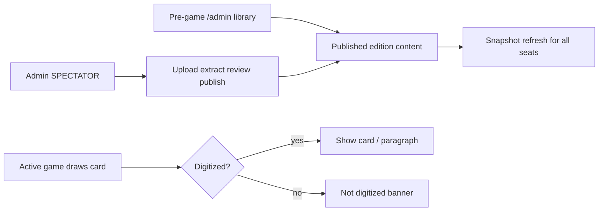

# Admin spectator for card digitizing

Pre-game bulk digitizing stays on the global content library; mid-play digitizing uses a SPECTATOR seat for an `app_admin` who can upload/extract/publish the currently missing card without taking a player turn.

## Recommendation

An **admin spectator** is the right shape.

- **Content is edition-scoped**, not per-game. Pre-game prep belongs on the existing global library at `/admin` ([`AdminContentClient.tsx`](../src/components/content/AdminContentClient.tsx)).
- **Mid-play digitizing needs live game context** (which card just came up). A `SPECTATOR` membership lets an admin watch the same realtime board without taking a seat in turn order, matching the roles already in the planning doc (`HOST` / `PLAYER` / `SPECTATOR` + global `app_admin`).
- Keep digitize authority on **`app_admin`**, not host: hosts fix game state; content publish stays a separate privilege (already how [`content-admin.ts`](../src/application/commands/content-admin.ts) works).

## What we will build

### 1. Pre-game: digitize before kickoff (library)

Enhance the existing admin library (no new game role needed):

- Keep `/admin` as the prep surface: progress bars vs `edition_manifest`, filters for Missing / Draft / Needs review.
- Add a **batch upload queue** (multi-file) that runs the same extract → review → publish path already in [`AdminContentClient`](../src/components/content/AdminContentClient.tsx) / [`content-admin.ts`](../src/application/commands/content-admin.ts).
- Optional lobby hint for hosts: “Content readiness” link to `/admin` when published counts are below manifest targets (read-only progress, not a blocker to start).

### 2. Mid-play: admin joins as SPECTATOR

`PlayerRole` already includes `SPECTATOR` in [`game.ts`](../src/domain/game/types/game.ts), but join always inserts `PLAYER` and counts every seat toward the 6-player cap ([`join-game.ts`](../src/application/commands/join-game.ts)).

Implement:

- **Join as spectator**: home/lobby control “Watch as spectator” → `JOIN_GAME` with `role: "SPECTATOR"` (or a dedicated `JOIN_AS_SPECTATOR` if we want a cleaner command).
- Spectators **do not consume player seats**, **do not get turn seats**, and are **excluded from turn order** in [`next-seat.ts`](../src/application/queries/next-seat.ts) / start-game / turn-control.
- Spectators still get a `game_players` row (membership for RLS/realtime), with a high/non-turn `seat` or null-friendly convention consistent with schema (`seat` is required today — use seats ≥ 100 or a dedicated spectator seat space and filter them out of turn logic).
- Game UI for spectators: board + encounter/readout, no move/draw/end-turn controls (same pattern as non-actor views in [`GameScreen.tsx`](../src/components/game/GameScreen.tsx)).

### 3. In-game digitize panel (admin + spectator)

When `snapshot.me.role === "SPECTATOR"` **and** the user is `app_admin`:

- Show a compact **Digitize** panel on the game screen.
- If the current encounter (or drawn card) is missing content, prefill type + card number from the snapshot and offer **Upload photo** → extract → review → **Publish** using existing content-admin commands.
- After publish, other clients pick up digitized content on the next snapshot refresh (existing load path / realtime).
- Align the player-facing missing banner in [`EncounterPanel.tsx`](../src/components/game/EncounterPanel.tsx) with the planning copy: keep physical-book continue; add “Ask admin to digitize” messaging (upload stays on the admin spectator, not every player).

### 4. Auth / permissions (locked)

| Who | Can watch live game | Can publish content |
|---|---|---|
| Player / Host | Yes (their seat) | Only if also `app_admin` |
| Spectator (non-admin) | Yes | No |
| Spectator + `app_admin` | Yes | Yes (mid-play digitize) |

No change to the rule that published content edits require `app_admin`.

## Out of scope for this slice

- Full GM tools beyond digitize (pause/undo stay host).
- Player-side photo upload from every seat (can add later if needed).
- Offline/bulk OCR of an entire deck in one shot beyond multi-file queue.

## Implementation order

1. Spectator join + exclude from turn order / seat cap.
2. Spectator game UI (read-only board).
3. In-game digitize drawer wired to existing content-admin extract/publish.
4. Batch upload on `/admin` for pre-game prep.
5. Lobby content-readiness link.

## Checklist

- [ ] Add SPECTATOR join path; exclude spectators from 6-player cap and turn order
- [ ] Read-only spectator game view (board + encounter, no player actions)
- [ ] Admin-spectator Digitize panel: upload/extract/review/publish for current missing card
- [ ] Multi-file batch upload queue on `/admin` for pre-game digitizing
- [ ] Lobby content-readiness link to `/admin` (non-blocking)
